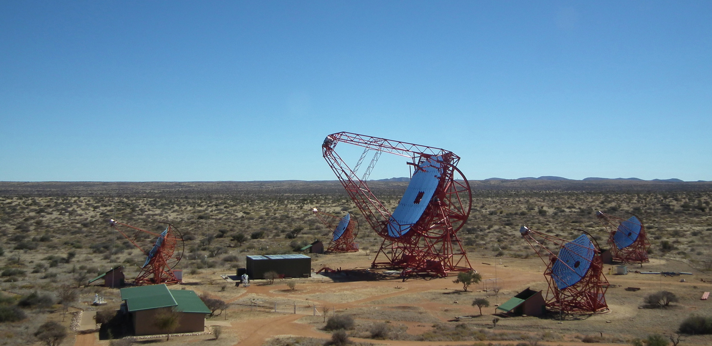
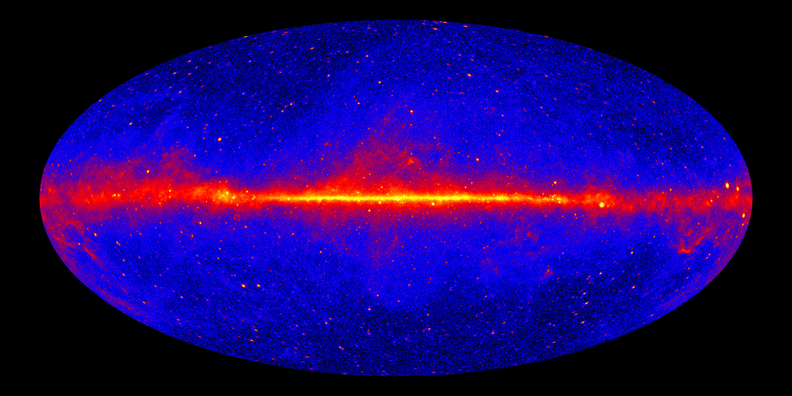
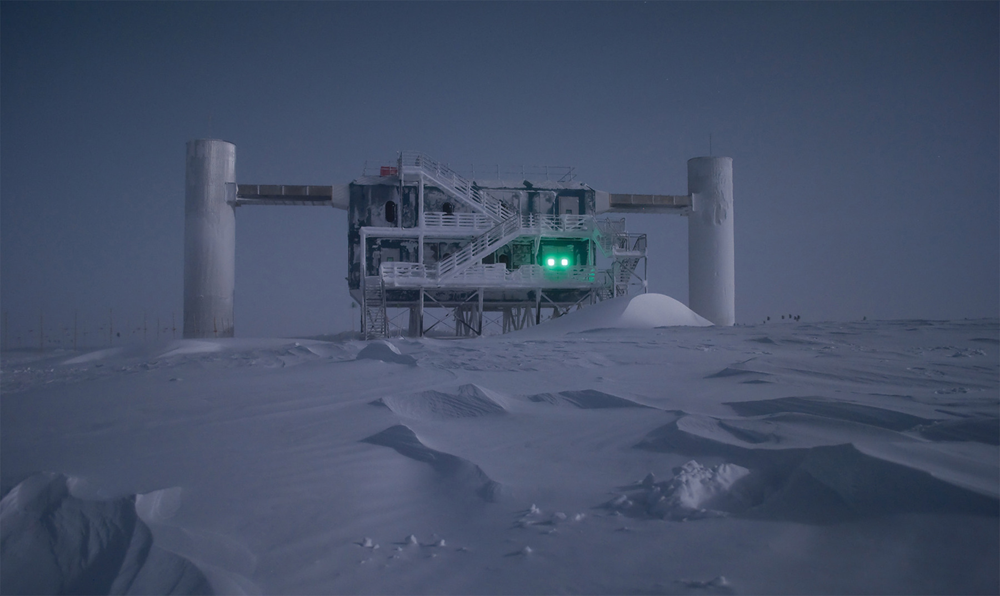
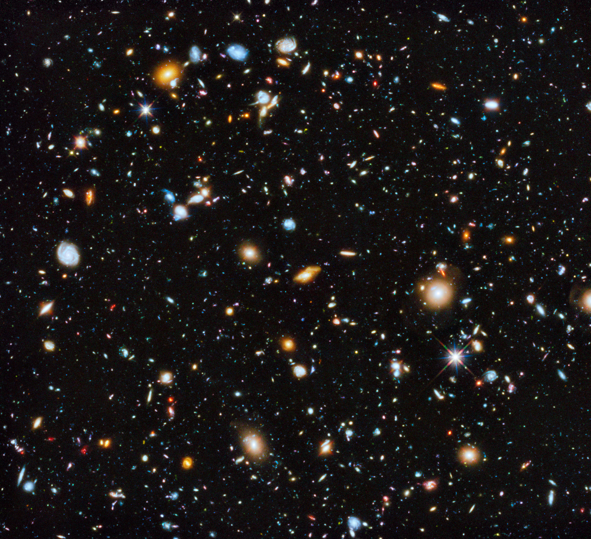
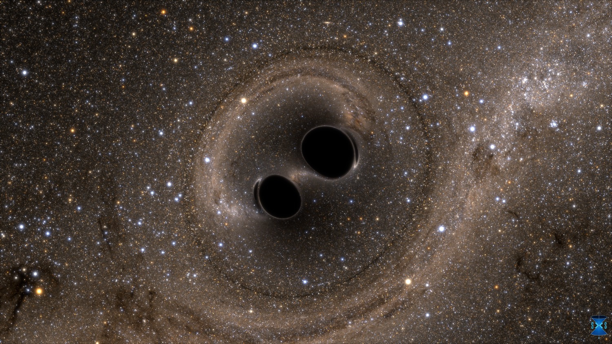
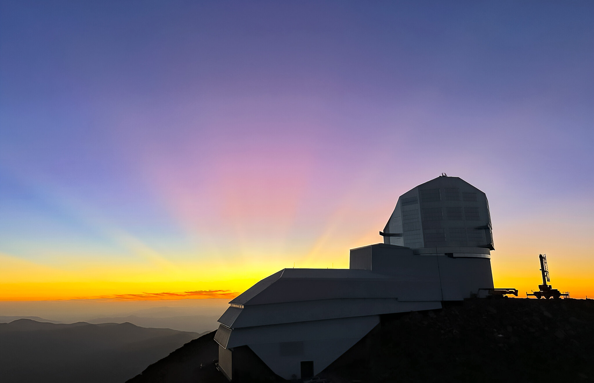
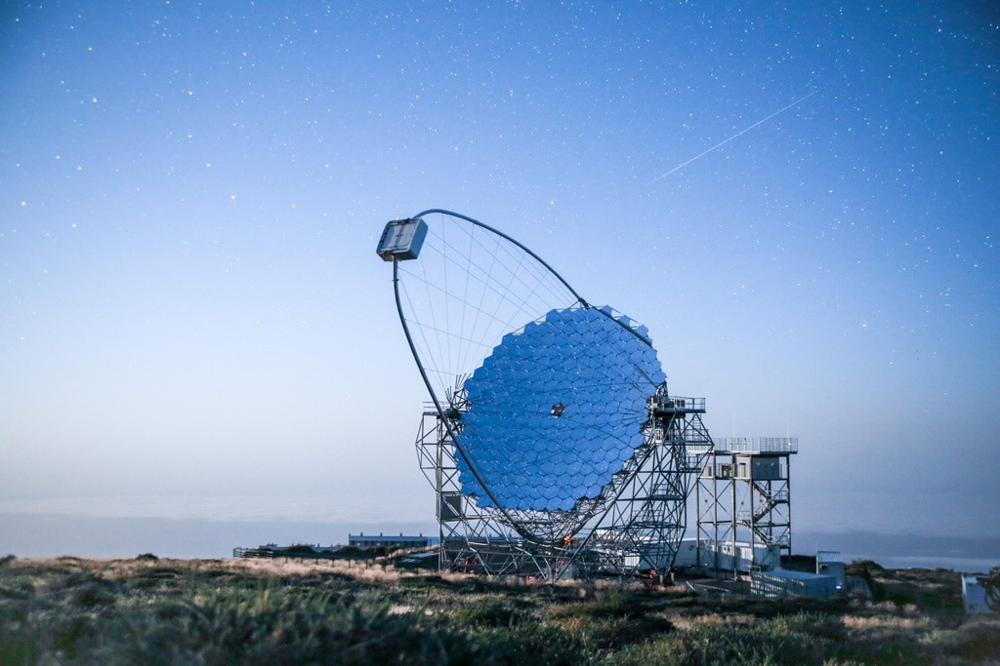

## Extragalactic gamma rays as probes of fundamental physics

I study some of the most energetic light that reaches us from space. Gamma rays carry information about particles accelerated to extraordinary energies in jets powered by black holes and in explosions in distant galaxies. By measuring this radiation, I try to understand how these objects work and whether they can help us test ideas about the fundamental laws of physics.

Much of my research follows gamma rays from their production to their arrival at Earth. Their changing brightness tells us about conditions near the source. Their journey across the Universe can leave traces of the light and particles they encounter along the way.

<nav class="research-topics" aria-label="Research topics">
  <a href="#black-hole-jets">Black-hole jets</a>
  <a href="#neutrinos-and-cosmic-rays">Neutrinos and cosmic rays</a>
  <a href="#cosmic-light-and-dark-matter">Cosmic light and dark matter</a>
  <a href="#hawking-radiation">Hawking radiation</a>
  <a href="#long-lived-bursts">Long-lived bursts</a>
  <a href="#preparing-for-ctao">Preparing for CTAO</a>
</nav>

### How do we observe gamma rays?

Earth's atmosphere absorbs gamma rays before they reach the ground. The Large Area Telescope (LAT) on NASA's Fermi Gamma-ray Space Telescope observes them from orbit, while telescopes such as H.E.S.S. in Namibia and VERITAS in Arizona use the atmosphere itself as part of the detector. When a gamma ray strikes the atmosphere, it starts a cascade of particles that produces a very brief flash of blue light. Large mirrors and fast cameras capture that flash and help us work out the energy and direction of the original gamma ray.

I combine these observations with measurements at other wavelengths, from radio waves to X-rays. Comparing how a source behaves across the spectrum helps us understand the particles producing its light.

<figure class="research-photo">
  
  <figcaption>
    The H.E.S.S. array in Namibia uses large mirrors and fast cameras to record the brief flashes produced when gamma rays strike the atmosphere.
    Credit: <a href="https://www.mpi-hd.mpg.de/HESS/pages/press/2012/HESS_II_first_light/">H.E.S.S. Collaboration, Frikkie van Greunen</a>.
  </figcaption>
</figure>

## Black-hole jets and their changing light {#black-hole-jets}

At the centre of many galaxies sits a black hole with millions or billions of times the mass of the Sun. In some galaxies, material falling towards the black hole powers narrow jets that travel outwards at close to the speed of light. When one of these jets points almost towards Earth, we call the source a *blazar*. This viewing angle makes blazars especially bright and allows us to study what happens inside their jets.

One question I keep returning to is where their gamma rays are produced. A jet can extend far beyond its host galaxy, yet its brightness can change within hours, or even minutes. Such rapid changes help us constrain the size of the emitting region. The surrounding light can also absorb gamma rays, leaving clues about how close that region is to the black hole.

I use these clues to investigate how particles gain and lose energy in jets. I also study flares that look different at different wavelengths, including optical outbursts with no obvious gamma-ray counterpart. Understanding when the light changes together, and when it does not, helps us test whether the emission comes from the same place and the same population of particles.

<figure class="research-photo">
  
  <figcaption>
    Fermi-LAT&#x27;s gamma-ray view of the sky. The bright band is our Milky Way, while many of the points away from it are distant active galaxies.
    Credit: <a href="https://science.nasa.gov/mission/fermi/">NASA/DOE/Fermi LAT Collaboration</a>.
  </figcaption>
</figure>

Related work:
  <a href="https://doi.org/10.1093/mnras/staa3483">Locating the gamma-ray emission region in bright blazars</a> 
  <a href="https://doi.org/10.3847/1538-4357/adb398">Searching for absorption signatures in distant blazars</a>

## Neutrinos and the origin of cosmic rays {#neutrinos-and-cosmic-rays}

Earth is constantly struck by particles from space known as cosmic rays. Most are protons or the nuclei of atoms, and some reach energies far beyond those achieved by our largest particle accelerators. Finding their sources is difficult because magnetic fields bend their paths during the journey to Earth.

Neutrinos offer another way to investigate. These particles have no electric charge and interact very rarely with matter. They can travel across the Universe without being deflected by magnetic fields. IceCube, a detector buried in the Antarctic ice, searches for the faint light produced when a neutrino interacts nearby.

I study gamma-ray observations of possible neutrino sources to investigate whether their jets accelerate protons as well as electrons. My work includes following up IceCube alerts and searching for radiation produced when cosmic rays escape a blazar and interact with background light on their way to us.

A neutrino arriving from the direction of a galaxy is a lead to investigate. Establishing a connection requires checking the timing, the other observations and the probability of a chance coincidence. Bringing these different kinds of evidence together is the basis of *multi-messenger astronomy*.

<figure class="research-photo">
  
  <figcaption>
    The IceCube Laboratory at the South Pole. Sensors buried deep in the ice detect light from particles produced in neutrino interactions.
    Credit: <a href="https://icecube.wisc.edu/gallery/landscapes-and-skyscapes/">Emanuel Jacobi, IceCube/NSF</a>.
  </figcaption>
</figure>

Related work:
  <a href="https://doi.org/10.3847/1538-4357/adb30c">Following up an IceCube alert towards B3 2247+381</a> 
  <a href="https://doi.org/10.3847/1538-4357/ae1d72">Searching for cosmic-ray cascade emission from TXS 0506+056</a>

## Cosmic background light and the search for dark matter {#cosmic-light-and-dark-matter}

The space between galaxies contains a faint background glow built up from the light of stars throughout cosmic history, including starlight absorbed and re-emitted by dust. We call this the *extragalactic background light*. A gamma ray can collide with one of these background photons and turn into an electron and its antimatter partner, a positron. Over a long enough journey, this makes distant galaxies appear fainter at high gamma-ray energies.

Measuring that dimming lets us study the background light itself. It also gives us a way to test ideas about dark matter, the unseen matter whose gravity helps hold galaxies together.

In one of my projects, I investigated hypothetical particles called *axion-like particles*. If these particles make up dark matter and slowly decay into light, they could add to the cosmic background glow. That extra light would change how many gamma rays reach us from distant blazars.

By combining Fermi-LAT and H.E.S.S. observations of eleven blazars, we found no significant evidence for this contribution. Under the assumption that these particles make up all of the dark matter, our measurements rule out some combinations of their mass and interaction strength.

<figure class="research-photo research-photo--square">
  
  <figcaption>
    Galaxies in the Hubble Ultra Deep Field. Their accumulated starlight, together with light re-emitted by dust, contributes to the background glow that gamma rays encounter.
    Credit: <a href="https://esahubble.org/images/heic1411a/">NASA, ESA, H. Teplitz and M. Rafelski (IPAC/Caltech), A. Koekemoer (STScI), R. Windhorst (Arizona State University), and Z. Levay (STScI)</a> (<a href="https://creativecommons.org/licenses/by/4.0/">CC BY 4.0</a>).
  </figcaption>
</figure>

Related work:
  <a href="https://doi.org/10.1088/1475-7516/2026/10/005">Gamma-ray constraints on heavy axion-like-particle decays</a>
  (<a href="https://arxiv.org/abs/2606.11923">open-access preprint</a>)

## Searching for Hawking radiation after black-hole mergers {#hawking-radiation}

Stephen Hawking predicted that black holes should emit radiation and gradually lose mass. For black holes as massive as stars, this radiation would be far too faint to detect with current instruments. Much smaller black holes would be hotter and could emit gamma rays.

I work on a search motivated by the hypothesis that a merger between two black holes might produce much smaller black holes, sometimes called *black-hole morsels*. Their formation is speculative. If they exist, however, their evaporation could produce gamma-ray emission arriving after the gravitational-wave signal from the merger.

Using Fermi-LAT observations of the merger GW170814, I search for the predicted signal and follow how its energy distribution should change as the small black holes lose mass. The analysis finds no evidence for such emission, allowing us to place limits on how much mass could have been released in these objects under the models we test.

This project connects a prediction from quantum physics with an astronomical observation. The gravitational waves tell us when and where a merger happened, giving us a specific place and time to search for its possible gamma-ray aftermath.

<figure class="research-photo">
  
  <figcaption>
    A computer visualisation of two merging black holes and the way their gravity distorts the light from background stars.
    Credit: <a href="https://www.ligo.caltech.edu/image/ligo20160211d">SXS, the Simulating eXtreme Spacetimes (SXS) project</a>.
  </figcaption>
</figure>

Earlier work:
  <a href="https://arxiv.org/abs/2509.17599">Searching for Hawking radiation with gamma-ray observations</a>

## Long-lived bursts in a changing sky {#long-lived-bursts}

Some cosmic explosions release a burst of gamma rays followed by an afterglow that fades across the electromagnetic spectrum. In a small number, the initial high-energy activity lasts for hours, much longer than in a typical long gamma-ray burst. These *ultra-long gamma-ray bursts* raise questions about what powers the explosion and how its central engine can keep running for so long.

I investigate how we might find and study these events through their optical afterglows with the Vera C. Rubin Observatory. Its repeated images of the sky provide a way to discover sources that appear or change brightness between visits.

My work uses observations of known bursts to simulate how they would look through Rubin's observing schedule. I test how often we would detect them, how early we could recognise an interesting event, and whether we would obtain enough measurements to follow its evolution. A source can be bright enough to see and still be missed if the telescope looks at the wrong time.

The aim is to identify promising events for follow-up at other wavelengths, including gamma rays, while there is still time to observe them. An important part of the work is checking which features really distinguish unusual bursts from more ordinary ones.

<figure class="research-photo">
  
  <figcaption>
    Vera C. Rubin Observatory on Cerro Pachón in Chile. Repeated images of the sky help us find explosions and follow how they fade.
    Credit: <a href="https://noirlab.edu/public/images/rubin3-CC/">NSF–DOE Vera C. Rubin Observatory/NOIRLab/SLAC/AURA/A. Alexov</a> (<a href="https://creativecommons.org/licenses/by/4.0/">CC BY 4.0</a>).
  </figcaption>
</figure>

## Preparing for the Cherenkov Telescope Array Observatory {#preparing-for-ctao}

The blazars we can detect are only part of a much larger population. Bright objects are easier to find, and a galaxy that is usually too faint can become visible during a flare. To understand the population as a whole, we need to account for what our telescopes can see and what they miss.

The Cherenkov Telescope Array Observatory, or *CTAO*, is being developed to observe the gamma-ray sky with greater sensitivity than existing Cherenkov telescopes. I use simulations of active galaxies to investigate which sources it could detect and how different observing strategies would affect the sample.

This involves connecting the properties of the galaxies with the performance of the telescopes. I am particularly interested in how observations during bright flares change our view of the population, and what a larger sample can tell us about black-hole jets over cosmic history.

As co-chair of the CTAO task force studying populations of active galaxies, I help coordinate this work. I also contribute to software for monitoring the Large-Sized Telescope camera networks, supporting the operation of the instruments that will make these observations possible.

<figure class="research-photo research-photo--compact">
  
  <figcaption>
    LST-1 at the Roque de los Muchachos Observatory on La Palma, one of the Large-Sized Telescopes being developed for CTAO.
    Credit: <a href="https://www.ctao.org/emission-to-discovery/array-sites/ctao-north/">Tomohiro Inada</a>.
  </figcaption>
</figure>

For the papers behind these projects, visit my [publications page](/publications/).
